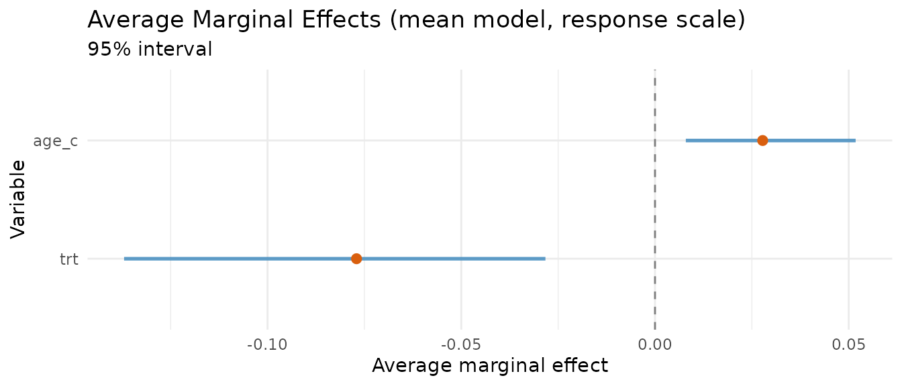
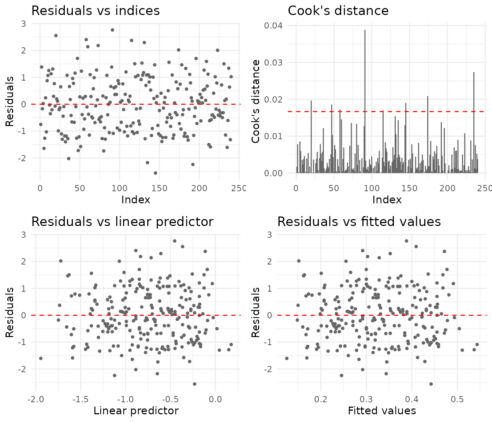
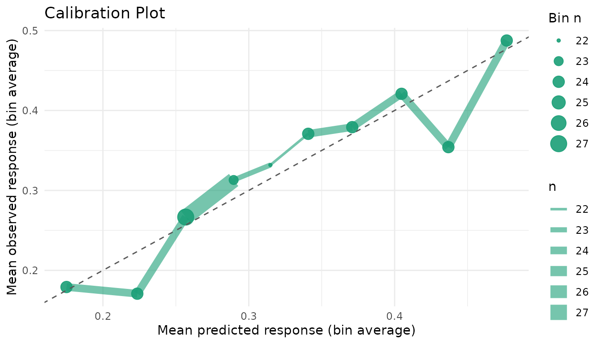
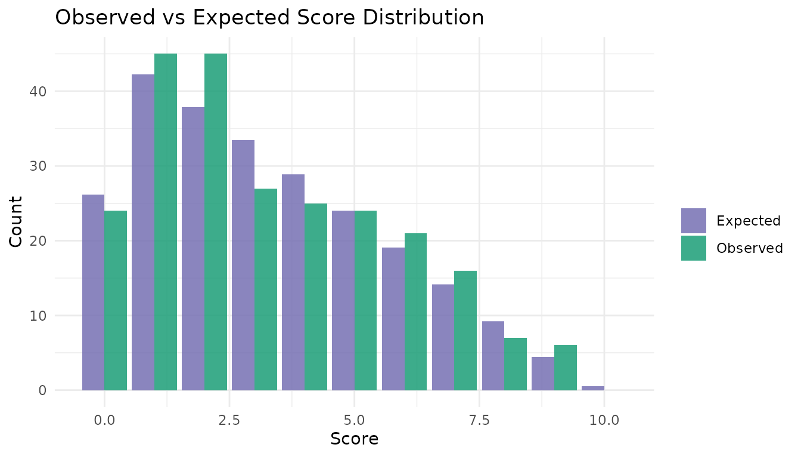
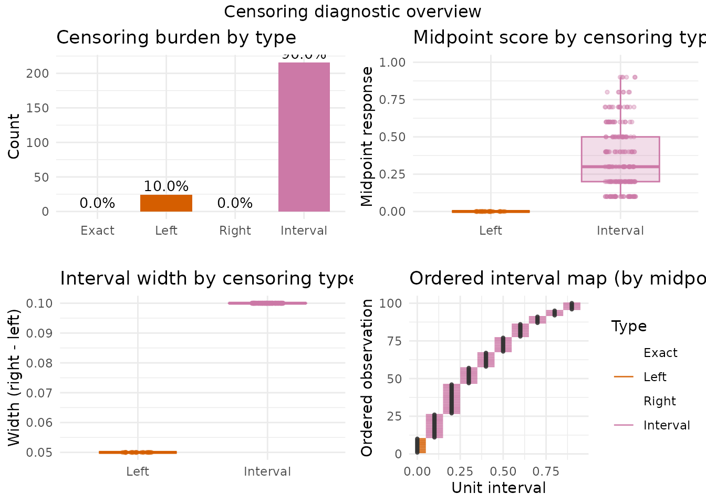
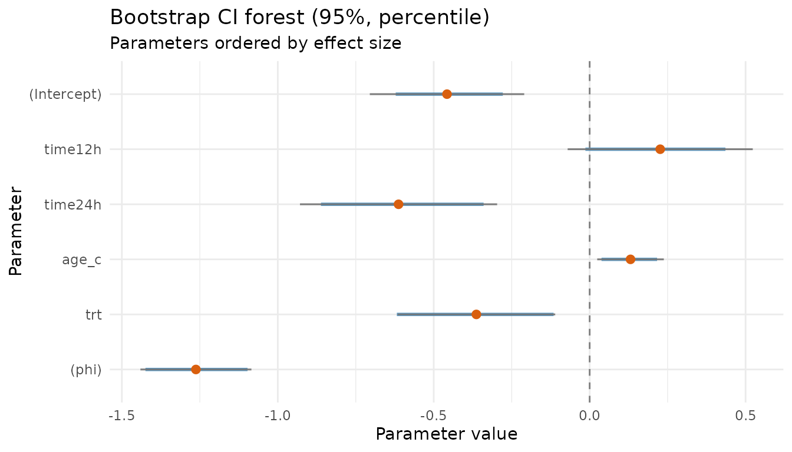

# Analyst tools: predictions, residuals and validation

This vignette shows the post-estimation tools for
[`brs()`](https://evandeilton.github.io/betaregscale/reference/brs.md)
fits: predictions on the mean and score scales, contrasts with standard
errors, marginal effects, residuals, plots, the parametric bootstrap,
cross-validation and summary tables. The model itself is described in
[`vignette("brs-intro")`](https://evandeilton.github.io/betaregscale/articles/brs-intro.md);
the mixed-model versions of these tools are in
[`vignette("brs-mm")`](https://evandeilton.github.io/betaregscale/articles/brs-mm.md).
Small numbers of replicates and folds keep the vignette fast, so the
results are illustrative.

``` r

library(betaregscale)
```

## Data and fit

Simulated NRS-11 scores of 240 patients at three post-operative times,
with age and a treatment indicator:

``` r

set.seed(2023)
nrs <- data.frame(
  time = factor(rep(c("6h", "12h", "24h"), each = 80),
                levels = c("6h", "12h", "24h")),
  age = round(rnorm(240, 50, 12)),
  trt = rbinom(240, 1, 0.5)
)
nrs$age_c <- (nrs$age - 50) / 10
eta <- -0.6 + c(0, 0.5, -0.3)[nrs$time] + 0.2 * nrs$age_c - 0.5 * nrs$trt
shp <- brs_repar(mu = plogis(eta), phi = 0.2, repar = 2)
nrs$y <- round(10 * rbeta(240, shp$shape1, shp$shape2))

fit <- brs(y ~ time + age_c + trt, data = nrs, ncuts = 10)
fit
#> 
#> Call:
#> brs(formula = y ~ time + age_c + trt, data = nrs, ncuts = 10)
#> 
#> Coefficients (mean model with logit link):
#> (Intercept)     time12h     time24h       age_c         trt 
#>     -0.4574      0.2262     -0.6128      0.1310     -0.3633 
#> 
#> Coefficients (dispersion model for sigma with logit link):
#>   (phi) 
#> -1.2626
```

## Predictions

[`predict()`](https://rdrr.io/r/stats/predict.html) returns, by `type`:

| `type` | value |
|:---|:---|
| `"response"` (default) | the mean $`E(Y) = \mu`$ on $`(0, 1)`$ |
| `"link"` | the linear predictor of the mean |
| `"precision"` | the second parameter on its own scale (the dispersion $`\sigma`$ under `repar = 2`) |
| `"variance"` | $`\mathrm{Var}(Y)`$ |
| `"quantile"` | quantiles of $`Y`$ at the probabilities `at` |
| `"score"` | the latent score at $`E(Y)`$ ($`K\,E(Y)`$ under `"mid"`) |
| `"expected_score"` | the expected recorded score $`\sum_s s\,P(S = s)`$ |

``` r

nd <- data.frame(time = c("6h", "12h", "24h"), age_c = 0, trt = 0)
cbind(nd,
      mu = predict(fit, nd),
      score = predict(fit, nd, type = "score"),
      expected_score = predict(fit, nd, type = "expected_score"))
#>   time age_c trt        mu    score expected_score
#> 1   6h     0   0 0.3875968 3.875968       3.873384
#> 2  12h     0   0 0.4424592 4.424592       4.423637
#> 3  24h     0   0 0.2553673 2.553673       2.539366
predict(fit, nd, type = "quantile", at = c(0.25, 0.5, 0.75))
#>          q_0.25     q_0.5    q_0.75
#> [1,] 0.19959732 0.3644270 0.5557468
#> [2,] 0.25391890 0.4305352 0.6207733
#> [3,] 0.08600763 0.2067570 0.3832926
```

[`brs_predict_scoreprob()`](https://evandeilton.github.io/betaregscale/reference/brs_predict_scoreprob.md)
gives the probability of each score, as a matrix or in long format:

``` r

round(brs_predict_scoreprob(fit, newdata = nd), 3)
#>      score_0 score_1 score_2 score_3 score_4 score_5 score_6 score_7 score_8
#> [1,]   0.042   0.134   0.152   0.151   0.141   0.124   0.102   0.077   0.051
#> [2,]   0.023   0.095   0.127   0.140   0.142   0.135   0.121   0.100   0.072
#> [3,]   0.158   0.235   0.180   0.139   0.105   0.076   0.052   0.032   0.017
#>      score_9 score_10
#> [1,]   0.024    0.003
#> [2,]   0.039    0.005
#> [3,]   0.005    0.000
head(brs_predict_scoreprob(fit, newdata = nd, scores = 0:2, format = "long"))
#>   id score       prob
#> 1  1     0 0.04181922
#> 2  1     1 0.13358466
#> 3  1     2 0.15198673
#> 4  2     0 0.02250122
#> 5  2     1 0.09524590
#> 6  2     2 0.12691577
```

## Score-scale quantities with standard errors

[`brs_marginal()`](https://evandeilton.github.io/betaregscale/reference/brs_marginal.md)
returns score probabilities (`type = "prob"`), expected scores
(`"expected_score"`) or exceedance probabilities $`P(S \ge k)`$
(`"exceed"`) with delta-method standard errors and Wald intervals,
computed on the logit scale for probabilities and expected scores so
they stay in range (contrasts use Wald intervals on the natural scale).
`contrast` gives differences between pairs of rows of `newdata`;
`c(i, j)` is row `i` minus row `j`:

``` r

brs_marginal(fit, nd, type = "exceed", k = 4)
#>   time age_c trt row k  estimate  std.error     lower     upper
#> 1   6h     0   0   1 4 0.5211590 0.05244215 0.4189245 0.6216513
#> 2  12h     0   0   2 4 0.6149118 0.05076843 0.5119463 0.7085225
#> 3  24h     0   0   3 4 0.2885185 0.04173023 0.2139919 0.3765655
brs_marginal(fit, nd, type = "expected_score",
             contrast = rbind(c(2, 1), c(3, 1)))
#>   contrast row1 row2   estimate std.error      lower      upper
#> 1    2 - 1    2    1  0.5502529 0.3675773 -0.1701853  1.2706912
#> 2    3 - 1    3    1 -1.3340178 0.3497652 -2.0195451 -0.6484905
```

With `se_method = "simulation"`, the standard errors and percentile
intervals come from `n_sim` draws of the parameters (set a seed first):

``` r

set.seed(1)
brs_marginal(fit, nd[1:2, ], type = "expected_score", contrast = c(2, 1),
             se_method = "simulation", n_sim = 200)
#>   contrast row1 row2  estimate std.error      lower    upper
#> 1    2 - 1    2    1 0.5502529 0.3636081 -0.1616128 1.275677
```

## Average marginal effects

[`brs_marginaleffects()`](https://evandeilton.github.io/betaregscale/reference/brs_marginaleffects.md)
gives the average marginal effect of each numeric covariate on the mean
(`type = "response"`) or on the linear predictor (`"link"`): a central
difference for continuous covariates and the discrete change for 0/1
covariates, averaged over the rows. Intervals use `n_sim` draws from the
asymptotic normal law of the estimates. Factors are not included; code a
factor as 0/1 dummies to get its contrast, or use
[`brs_marginal()`](https://evandeilton.github.io/betaregscale/reference/brs_marginal.md)
contrasts as above.

``` r

set.seed(2)
ame <- brs_marginaleffects(fit, n_sim = 100, keep_draws = TRUE)
ame
#>   variable         ame  std.error     ci.lower    ci.upper model     type   n
#> 1    age_c  0.02778234 0.01051475  0.007953519  0.05177403  mean response 240
#> 2      trt -0.07703774 0.02756216 -0.137031764 -0.02828654  mean response 240
```

Effects on $`E(Y)`$ are on $`(0, 1)`$; multiply by $`K`$ for the score
scale under `"mid"`.

``` r

autoplot.brs_marginaleffects(ame, type = "forest")
```



## Residuals

[`residuals()`](https://rdrr.io/r/stats/residuals.html) offers the types
below. The randomized quantile residuals (`"rqr"`, Dunn and Smyth, 1996)
are standard normal under the model whatever the censoring and are the
recommended type for diagnostics.

| `type` | definition |
|:---|:---|
| `"response"` (default) | `yt` minus the fitted mean |
| `"pearson"` | response residual over the fitted SD |
| `"deviance"` | beta deviance residual at `yt` |
| `"rqr"` | $`\Phi^{-1}(u_i)`$, $`u_i`$ uniform on $`(F(l_i), F(u_i))`$, with 0 and 1 at the borders |
| `"weighted"`, `"sweighted"` | residuals on the $`\mathrm{logit}(Y)`$ scale (Espinheira et al., 2008) |
| `"cell_deviance"` | $`\mathrm{sign}_i\sqrt{-2\log P_i}`$ from the probability of the observed cell |

All types except `"rqr"` and `"cell_deviance"` use one point of the
cell, `yt`: $`s/K`$ under `"mid"` (so the border scores sit at
$`10^{-5}`$ and $`1 - 10^{-5}`$) and the cell center under
`"right"`/`"left"`. They are unreliable at the border scores. The cell
deviance residuals are signed by the observed minus the expected score;
for score data their squares add up to $`-2\log L`$:

``` r

set.seed(1)
r_q <- residuals(fit, type = "rqr")
c(mean = mean(r_q), sd = sd(r_q))
#>      mean        sd 
#> 0.0026605 0.9873903
r_d <- residuals(fit, type = "cell_deviance")
c(sum_sq = sum(r_d^2), minus2logLik = -2 * as.numeric(logLik(fit)))
#>       sum_sq minus2logLik 
#>     997.6295     997.6295
```

## Plots

[`plot()`](https://rdrr.io/r/graphics/plot.default.html) draws up to six
diagnostic panels of quantile residuals (four by default) in base
graphics or, with `gg = TRUE`, ggplot2:

``` r

plot(fit, gg = TRUE)
```



[`autoplot.brs()`](https://evandeilton.github.io/betaregscale/reference/autoplot.brs.md)
adds a calibration plot, the predicted score distribution, fitted CDFs
and residuals by censoring type:

``` r

autoplot.brs(fit, type = "calibration")
```



``` r

autoplot.brs(fit, type = "score_dist")
```



[`brs_cens()`](https://evandeilton.github.io/betaregscale/reference/brs_cens.md)
summarizes the censoring types of a fit:

``` r

brs_cens(fit, gg = TRUE)
```



## Parametric bootstrap

[`brs_bootstrap()`](https://evandeilton.github.io/betaregscale/reference/brs_bootstrap.md)
draws new responses at the fitted shapes, re-coarsens them on the fit’s
cells and refits the original formula, `R` times. It returns percentile,
basic, normal or BCa intervals next to the Wald intervals; failed refits
are counted and printed. Use `R` of at least 199 in practice; 49 is used
here for speed.

``` r

set.seed(3)
boot <- brs_bootstrap(fit, R = 49, keep_draws = TRUE)
boot
#> Bootstrap confidence intervals
#>   Level: 0.95 | CI: percentile | Successful replicates: 49 / 49 | Attempts: 49 
#>   Failed replicates: 0 (0.0% of attempts)
#> 
#>     parameter   estimate    se_boot    ci_lower   ci_upper  mcse_lower
#> 1 (Intercept) -0.4574253 0.10590803 -0.62188294 -0.2784529 0.014002539
#> 2     time12h  0.2262380 0.13772964 -0.01369945  0.4354400 0.021238726
#> 3     time24h -0.6127630 0.14066571 -0.86158613 -0.3400873 0.042576014
#> 4       age_c  0.1310349 0.05142949  0.03795532  0.2162490 0.009765608
#> 5         trt -0.3632532 0.13790026 -0.61820543 -0.1155792 0.034133318
#> 6       (phi) -1.2625569 0.08818543 -1.42443996 -1.0969682 0.014821330
#>    mcse_upper  wald_lower wald_upper level
#> 1 0.039331479 -0.70499315 -0.2098574  0.95
#> 2 0.021264851 -0.07056248  0.5230386  0.95
#> 3 0.024659677 -0.92888949 -0.2966365  0.95
#> 4 0.007618617  0.02425109  0.2378187  0.95
#> 5 0.030051529 -0.61610640 -0.1103999  0.95
#> 6 0.031921648 -1.44051168 -1.0846021  0.95
```

``` r

autoplot.brs_bootstrap(boot, type = "ci_forest")
```



## Cross-validation

[`brs_cv()`](https://evandeilton.github.io/betaregscale/reference/brs_cv.md)
runs repeated k-fold cross-validation. For each held-out fold it reports
`log_score`, the mean log probability of the held-out observations
(higher is better), and the RMSE and MAE of `yt` around the predicted
mean:

``` r

set.seed(4)
cv_full <- brs_cv(y ~ time + age_c + trt, data = nrs, k = 5, ncuts = 10)
set.seed(4)
cv_time <- brs_cv(y ~ time, data = nrs, k = 5, ncuts = 10)
cv_full
#>   repeat fold n_train n_test log_score   rmse_yt    mae_yt converged error
#> 1      1    1     192     48 -2.028631 0.2001736 0.1618597      TRUE  <NA>
#> 2      1    2     192     48 -2.168236 0.2422893 0.2152613      TRUE  <NA>
#> 3      1    3     192     48 -2.185514 0.2470601 0.2150859      TRUE  <NA>
#> 4      1    4     192     48 -2.076509 0.2360192 0.1934935      TRUE  <NA>
#> 5      1    5     192     48 -2.040262 0.2026502 0.1702655      TRUE  <NA>
c(full = mean(cv_full$log_score), time_only = mean(cv_time$log_score))
#>      full time_only 
#> -2.099831 -2.122464
```

Resetting the seed gives both models the same folds.

## Tables

[`brs_est()`](https://evandeilton.github.io/betaregscale/reference/brs_est.md)
gives the coefficient table,
[`brs_gof()`](https://evandeilton.github.io/betaregscale/reference/brs_gof.md)
the fit criteria and
[`brs_table()`](https://evandeilton.github.io/betaregscale/reference/brs_table.md)
a comparison of several fits with their censoring counts:

``` r

brs_est(fit)
#>      variable   estimate         se    z_value      p_value    ci_lower
#> 1 (Intercept) -0.4574253 0.12631247  -3.621379 2.930372e-04 -0.70499315
#> 2     time12h  0.2262380 0.15143162   1.493995 1.351770e-01 -0.07056248
#> 3     time24h -0.6127630 0.16129199  -3.799091 1.452277e-04 -0.92888949
#> 4       age_c  0.1310349 0.05448253   2.405081 1.616889e-02  0.02425109
#> 5         trt -0.3632532 0.12900912  -2.815717 4.866855e-03 -0.61610640
#> 6       (phi) -1.2625569 0.09079493 -13.905588 5.858310e-44 -1.44051168
#>     ci_upper
#> 1 -0.2098574
#> 2  0.5230386
#> 3 -0.2966365
#> 4  0.2378187
#> 5 -0.1103999
#> 6 -1.0846021
fit_time <- brs(y ~ time, data = nrs, ncuts = 10)
brs_table(full = fit, time_only = fit_time, sort_by = "AIC")
#>       model nobs npar    logLik      AIC      BIC pseudo_r2 exact left right
#> 1      full  240    6 -498.8148 1009.630 1030.513    0.1668     0   24     0
#> 2 time_only  240    4 -506.3028 1020.606 1034.528    0.1013     0   24     0
#>   interval prop_exact prop_left prop_right prop_interval
#> 1      216          0       0.1          0           0.9
#> 2      216          0       0.1          0           0.9
```

## References

- Dunn, P. K., and Smyth, G. K. (1996). Randomized quantile residuals.
  *Journal of Computational and Graphical Statistics*, 5(3), 236–244.
- Espinheira, P. L., Ferrari, S. L. P., and Cribari-Neto, F. (2008). On
  beta regression residuals. *Journal of Applied Statistics*, 35(4),
  407–419.
- Lopes, J. E. (2023). *Modelos de regressão beta para dados de escala*.
  Master’s dissertation, Universidade Federal do Paraná, Curitiba.
  <https://hdl.handle.net/1884/86624>
