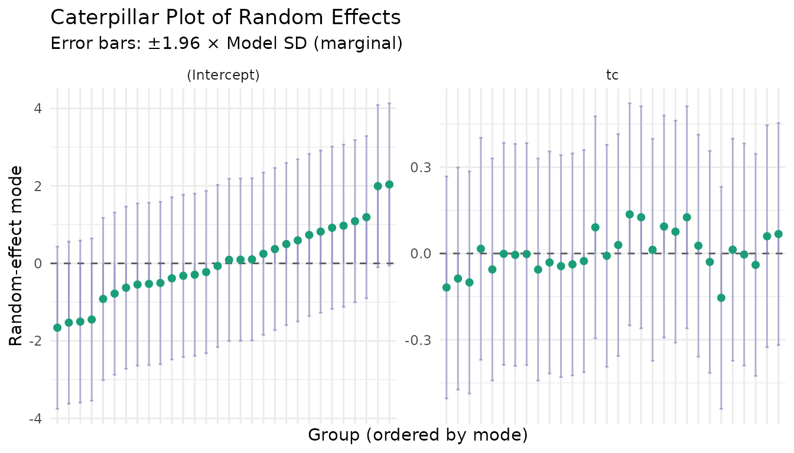

# Mixed models with brsmm

[`brsmm()`](https://evandeilton.github.io/betaregscale/reference/brsmm.md)
adds Gaussian random effects to the mean submodel of
[`brs()`](https://evandeilton.github.io/betaregscale/reference/brs.md)
for clustered or longitudinal scores (patients with repeated visits,
raters, centers). This vignette covers the model, the integration
methods, random-effect summaries and tests, marginal and conditional
predictions, residuals, group-level cross-validation and simulation. The
interval-censored likelihood and the interval maps are those of
[`vignette("brs-intro")`](https://evandeilton.github.io/betaregscale/articles/brs-intro.md).
The data sets are small so that the vignette builds quickly; the results
are illustrative.

``` r

library(betaregscale)
```

## The model

For observation $`i`$ of group $`g`$,
``` math
g_1(\mu_{gi}) = x_{gi}^\top \beta + w_{gi}^\top b_g, \qquad
g_2(\sigma_{gi}) = z_{gi}^\top \gamma, \qquad b_g \sim N(0, D),
```
where $`w_{gi}`$ is the row of the random-effects design given by
`random = ~ terms | group` (`~ 1 | id` for a random intercept,
`~ 1 + x | id` for an intercept and a slope with a free correlation).
The dispersion submodel has no random effects. Given $`b_g`$, each score
contributes the cell probability of
[`brs()`](https://evandeilton.github.io/betaregscale/reference/brs.md),
and the marginal log-likelihood is
``` math
\ell(\theta) = \sum_g \log \int \prod_i P(S_{gi} = s_{gi} \mid b)\,
\varphi(b; 0, D)\, db .
```
$`D = LL^\top`$ is parameterized by its lower Cholesky factor: the log
of each diagonal entry and the off-diagonal entries. These are the
`(re_chol_logsd)_` and `(re_chol)_` entries of
[`coef()`](https://rdrr.io/r/stats/coef.html); for a random intercept
the single entry is $`\log \mathrm{SD}(b)`$.

## Integration methods

The integral is computed around the mode $`\hat b_g`$ of the log
integrand, with curvature $`H_g`$ there:

- `int_method = "laplace"` (default): the Laplace approximation, fast
  and accurate when groups are not tiny.
- `int_method = "aghq"`: adaptive Gauss–Hermite quadrature with
  `n_points` nodes per dimension (default 11) on a product grid centered
  at $`\hat b_g`$ and scaled by $`H_g^{-1/2}`$ (at most 500000 nodes).
- `int_method = "qmc"`: importance sampling from
  $`N(\hat b_g, H_g^{-1})`$ on `qmc_points` Halton points (default
  1024). It is deterministic and, with two or more random effects,
  slightly underestimates the log-likelihood; prefer `"aghq"` for up to
  three random effects.

[`optim()`](https://rdrr.io/r/stats/optim.html) uses the compiled
gradient of the chosen approximation; the Hessian for
[`vcov()`](https://rdrr.io/r/stats/vcov.html) is a central difference of
that gradient.

## Simulated data

[`brsmm_sim()`](https://evandeilton.github.io/betaregscale/reference/brsmm_sim.md)
simulates scores from this model, given the random-effect standard
deviations and correlation. Here: 30 patients with four visits on an
NRS-11 scale, a centered time `tc`, a treatment arm `trt`, and a random
intercept and time slope:

``` r

d <- expand.grid(visit = 1:4, id = 1:30)
d$tc <- (d$visit - 2.5) / 1.5
d$trt <- as.integer(d$id %% 2 == 0)
set.seed(7)
s <- brsmm_sim(~ tc + trt, random = ~ 1 + tc | id, data = d,
               beta = c(-0.3, -0.4, -0.5), phi = qlogis(0.15),
               re_sd = c(0.8, 0.3), re_cor = 0.3, ncuts = 10)
head(s)
#>      left right    yt y delta visit id         tc trt
#> 1 0.85000  0.95 9e-01 9     3     1  1 -1.0000000   0
#> 2 0.85000  0.95 9e-01 9     3     2  1 -0.3333333   0
#> 3 0.55000  0.65 6e-01 6     3     3  1  0.3333333   0
#> 4 0.55000  0.65 6e-01 6     3     4  1  1.0000000   0
#> 5 0.25000  0.35 3e-01 3     3     1  2 -1.0000000   1
#> 6 0.00001  0.05 1e-05 0     1     2  2 -0.3333333   1
attr(s, "truth")$par
#>                    (Intercept)                             tc 
#>                     -0.3000000                     -0.4000000 
#>                            trt              (phi)_(Intercept) 
#>                     -0.5000000                     -1.7346011 
#> (re_chol_logsd)_(Intercept)|id    (re_chol)_tc:(Intercept)|id 
#>                     -0.2231436                      0.0900000 
#>          (re_chol_logsd)_tc|id 
#>                     -1.2511281
```

The attribute `"truth"` holds the true parameters in the order and on
the scale of [`coef()`](https://rdrr.io/r/stats/coef.html), and
`"ranef"` the simulated random effects.

## Fitting

``` r

fit_ri <- brsmm(y ~ tc + trt, random = ~ 1 | id, data = s)
fit_rs <- brsmm(y ~ tc + trt, random = ~ 1 + tc | id, data = s)
summary(fit_rs)
#> 
#> Call:
#> brsmm(formula = y ~ tc + trt, random = ~1 + tc | id, data = s)
#> 
#> Randomized Quantile Residuals:
#>     Min      1Q  Median      3Q     Max 
#> -2.5557 -0.6204  0.0051  0.4749  2.9221 
#> 
#> Coefficients (mean model with logit link):
#>             Estimate Std. Error z value Pr(>|z|)   
#> (Intercept)  0.08037    0.29963   0.268   0.7885   
#> tc          -0.36923    0.11697  -3.157   0.0016 **
#> trt         -0.73612    0.42983  -1.713   0.0868 . 
#> ---
#> Signif. codes:  0 '***' 0.001 '**' 0.01 '*' 0.05 '.' 0.1 ' ' 1
#> 
#> Coefficients (dispersion model for sigma with logit link):
#>             Estimate Std. Error z value Pr(>|z|)    
#> (Intercept)  -1.7568     0.2094  -8.391   <2e-16 ***
#> ---
#> Signif. codes:  0 '***' 0.001 '**' 0.01 '*' 0.05 '.' 0.1 ' ' 1
#> 
#> Random effects (SD and Corr; 95% Wald CI on the log / atanh scale; no tests, see anova()):
#>                     Estimate   Lower  Upper
#> SD (Intercept)        1.0686  0.7727 1.4779
#> SD tc                 0.1970  0.0095 4.0923
#> Corr tc,(Intercept)   0.1645 -0.8639 0.9276
#> ---
#> Mixed beta interval model (Laplace)
#> Observations: 120  | Groups: 30 
#> Log-likelihood: -253.8471 on 7 Df | AIC: 521.6942 | BIC: 541.2066 
#> Pseudo R-squared: 0.0788 
#> Number of iterations: 64 (BFGS) 
#> Censoring: 102 interval | 10 left | 8 right
```

The random-effects block reports the standard deviations and the
correlation with intervals built on the log scale (SD) and the
$`\mathrm{atanh}`$ scale (correlation) and mapped back. It gives no
$`z`$-test: a variance of zero lies on the boundary of the parameter
space, so test it with [`anova()`](https://rdrr.io/r/stats/anova.html)
(below). The same numbers are in `summary(fit)$varcorr`.

The three integration methods give nearly the same estimates on this
data:

``` r

fit_aghq <- brsmm(y ~ tc + trt, random = ~ 1 | id, data = s,
                  int_method = "aghq", n_points = 7)
fit_qmc <- brsmm(y ~ tc + trt, random = ~ 1 | id, data = s,
                 int_method = "qmc", qmc_points = 256)
round(cbind(laplace = c(coef(fit_ri), logLik = logLik(fit_ri)),
            aghq = c(coef(fit_aghq), logLik = logLik(fit_aghq)),
            qmc = c(coef(fit_qmc), logLik = logLik(fit_qmc))), 4)
#>                                  laplace      aghq       qmc
#> (Intercept)                       0.0744    0.0751    0.0741
#> tc                               -0.3611   -0.3599   -0.3602
#> trt                              -0.7140   -0.7163   -0.7160
#> (phi)_(Intercept)                -1.7110   -1.7104   -1.7100
#> (re_chol_logsd)_(Intercept)|id    0.0545    0.0665    0.0641
#> logLik                         -253.9230 -253.3591 -253.4076
```

## Random effects

[`ranef()`](https://evandeilton.github.io/betaregscale/reference/ranef.md)
returns the conditional modes $`\hat b_g`$, one row per group;
`fit$random$D` and `fit$random$sd_b` hold the estimated covariance
matrix and standard deviations:

``` r

head(ranef(fit_rs))
#>   (Intercept)           tc
#> 1   0.8194782 -0.029209222
#> 2  -1.5034029 -0.100498130
#> 3  -1.5294370 -0.087103237
#> 4  -0.5462813 -0.002064520
#> 5  -0.7803565 -0.001166132
#> 6  -0.9184533 -0.055430537
fit_rs$random$D
#>            [,1]       [,2]
#> [1,] 1.14198316 0.03463383
#> [2,] 0.03463383 0.03881125
```

[`brsmm_re_study()`](https://evandeilton.github.io/betaregscale/reference/brsmm_re_study.md)
summarizes the random effects: the covariance, the shrinkage of the
modes and the intraclass correlation of $`\mathrm{logit}(Y)`$, computed
with the beta level-1 variance:

``` r

brsmm_re_study(fit_rs)
#> 
#> Random-effects study
#> Groups: 30 
#> 
#> Random-effects (VarCorr):
#>   Name                      Std.Dev.  Corr
#>   (Intercept)                 1.0686
#>   tc                          0.1970  0.1645
#> 
#> ICC (logit(Y) scale, beta level-1 variance): 0.5704
#> 
#> Summary by term (SD_model = model SD; shrinkage = Var(modes)/Var(model)):
#>         term sd_model mean_mode sd_mode shrinkage_ratio shapiro_p
#>  (Intercept)   1.0686    0.0138  0.9665          0.8179    0.6541
#>           tc   0.1970    0.0026  0.0725          0.1354    0.7503
```

``` r

autoplot.brsmm(fit_rs, type = "ranef_caterpillar")
```



[`autoplot.brsmm()`](https://evandeilton.github.io/betaregscale/reference/autoplot.brsmm.md)
also draws `"ranef_density"`, `"ranef_pairs"`, `"ranef_qq"`,
`"shrinkage"`, `"calibration"`, `"score_dist"` and
`"residuals_by_group"`;
[`plot.brsmm()`](https://evandeilton.github.io/betaregscale/reference/plot.brsmm.md)
gives the panels of
[`plot.brs()`](https://evandeilton.github.io/betaregscale/reference/plot.brs.md)
with response or Pearson residuals, plus random-effect panels.

## Testing variance components

Adding a random-effect term puts its variance on the boundary of the
parameter space under the null hypothesis, so the likelihood ratio does
not follow $`\chi^2_d`$. When a model adds one random-effect term,
[`anova()`](https://rdrr.io/r/stats/anova.html) uses the mixture
$`\frac12\chi^2_{d-1} + \frac12\chi^2_d`$ (Self and Liang, 1987; Stram
and Lee, 1994): $`\frac12\chi^2_0 +
\frac12\chi^2_1`$ from
[`brs()`](https://evandeilton.github.io/betaregscale/reference/brs.md)
to a random intercept, and $`\frac12\chi^2_1 + \frac12\chi^2_2`$ from a
random intercept to an intercept and slope. The heading of the table
says which rows use it.

``` r

fit_0 <- brs(y ~ tc + trt, data = s)
anova(fit_0, fit_ri, fit_rs)
#> Likelihood-ratio comparison of brs/brsmm models
#> Rows M2, M3: one added random effect (variance on the boundary); Pr(>Chisq) from the chi-bar-square mixture 1/2 chi2(Df - 1) + 1/2 chi2(Df).
#> 
#>            Df  logLik    AIC    BIC   Chisq Chi Df Pr(>Chisq)    
#> M1 (brs)    4 -279.98 567.97 579.12                              
#> M2 (brsmm)  5 -253.92 517.85 531.78 52.1196      1  2.611e-13 ***
#> M3 (brsmm)  7 -253.85 521.69 541.21  0.1517      2     0.8119    
#> ---
#> Signif. codes:  0 '***' 0.001 '**' 0.01 '*' 0.05 '.' 0.1 ' ' 1
```

When a variance is essentially zero,
[`brsmm()`](https://evandeilton.github.io/betaregscale/reference/brsmm.md)
warns “Variance component at the boundary”; rely on the likelihood-ratio
test for that term.

[`AIC()`](https://rdrr.io/r/stats/AIC.html) and
[`BIC()`](https://rdrr.io/r/stats/AIC.html) accept several fits, `brs`
and `brsmm` alike, and return a `df`/criterion table as
[`stats::AIC()`](https://rdrr.io/r/stats/AIC.html) and
[`stats::BIC()`](https://rdrr.io/r/stats/AIC.html) do. There is no
single sample size for a mixed model:
[`BIC()`](https://rdrr.io/r/stats/AIC.html) counts observations by
default and groups with `n = "groups"`. Compare BIC values only under
the same convention.

``` r

AIC(fit_0, fit_ri, fit_rs)
#>        df      AIC
#> fit_0   4 567.9655
#> fit_ri  5 517.8459
#> fit_rs  7 521.6942
BIC(fit_ri, fit_rs)
#>        df      BIC
#> fit_ri  5 531.7834
#> fit_rs  7 541.2066
BIC(fit_ri, fit_rs, n = "groups")
#>        df      BIC
#> fit_ri  5 524.8519
#> fit_rs  7 531.5026
```

## Conditional and marginal predictions

[`predict()`](https://rdrr.io/r/stats/predict.html) gives conditional
quantities: a group of the fit uses its mode $`\hat b_g`$, a new group
gets $`b = 0`$:

``` r

nd <- data.frame(tc = 0, trt = 1, id = c(1, 999))
predict(fit_ri, newdata = nd, type = "expected_score")
#> [1] 5.448165 3.453218
```

Under a nonlinear link, the prediction at $`b = 0`$ describes a subject
whose random effects are zero, which is not the population average.
[`brs_marginal()`](https://evandeilton.github.io/betaregscale/reference/brs_marginal.md)
integrates the random effects out to give population-averaged score
probabilities, expected scores and exceedance probabilities
$`P(S \ge k)`$, with delta-method standard errors over all parameters;
`conditional = TRUE` sets $`b = 0`$ instead. The grouping variable is
not needed in `newdata`:

``` r

nd <- data.frame(tc = c(-1, 1), trt = 1)
brs_marginal(fit_ri, nd, type = "expected_score")
#>   tc trt row estimate std.error    lower    upper
#> 1 -1   1   1 4.433166 0.6380772 3.242149 5.693117
#> 2  1   1   2 3.048002 0.5686567 2.057841 4.259101
brs_marginal(fit_ri, nd, type = "expected_score", conditional = TRUE)
#>   tc trt row estimate std.error    lower    upper
#> 1 -1   1   1 4.308536 0.7745230 2.895803 5.843569
#> 2  1   1   2 2.684320 0.6323208 1.633255 4.081798
```

Differences between rows, such as the change from the first to the last
visit in $`P(S \ge 5)`$, are given by `contrast`:

``` r

brs_marginal(fit_ri, nd, type = "exceed", k = 5, contrast = c(2, 1))
#>   contrast row1 row2 k   estimate  std.error      lower       upper
#> 1    2 - 1    2    1 5 -0.1981716 0.06312098 -0.3218864 -0.07445672
```

## Residuals

For `type = "rqr"` (randomized quantile residuals) and
`"cell_deviance"`, `re` selects how the random effects enter:

- `"conditional"` (default): at the modes $`\hat b_g`$. The modes are
  shrunk toward zero, so the rqr residuals are not exactly $`N(0, 1)`$
  under the model, especially for small groups.
- `"marginal"`: from the marginal distribution of each observation, with
  the random effects integrated out. The rqr residuals are $`N(0, 1)`$
  under the model; residuals of the same group are correlated.
- `"posterior"`: at one draw of each $`b_g`$ from its posterior
  (importance resampling with `n_draws` proposals per group, default
  200). The rqr residuals are close to independent $`N(0, 1)`$ under the
  model, without the shrinkage of the modes.

``` r

set.seed(1)
res <- sapply(c("conditional", "marginal", "posterior"), function(r)
  residuals(fit_ri, type = "rqr", re = r))
round(rbind(mean = colMeans(res), sd = apply(res, 2, sd)), 3)
#>      conditional marginal posterior
#> mean      -0.013    0.007     0.003
#> sd         0.883    1.019     0.999
```

The other types of
[`residuals.brs()`](https://evandeilton.github.io/betaregscale/reference/residuals.brs.md)
(`"response"`, `"pearson"`, …) are evaluated at the conditional modes.

## Group-level cross-validation

[`brsmm_cv()`](https://evandeilton.github.io/betaregscale/reference/brsmm_cv.md)
forms folds by group, so all observations of a group are held out
together. Each held-out group is scored by its marginal log-likelihood
at the training estimates: its random effects are integrated out, so no
estimate of them is needed. `seed` makes the folds reproducible, and
`attr(, "folds")` returns them for reuse with another model:

``` r

cv_ri <- brsmm_cv(y ~ tc + trt, random = ~ 1 | id, data = s, k = 3, seed = 1)
cv_ri
#>   repeat fold n_groups_train n_groups_test n_train n_test log_score converged
#> 1      1    1             20            10      80     40 -84.01975      TRUE
#> 2      1    2             20            10      80     40 -85.92605      TRUE
#> 3      1    3             20            10      80     40 -87.83580      TRUE
#>   error warning
#> 1  <NA>    <NA>
#> 2  <NA>    <NA>
#> 3  <NA>    <NA>
folds <- attr(cv_ri, "folds")[[1]]
cv_rs <- brsmm_cv(y ~ tc + trt, random = ~ 1 + tc | id, data = s,
                  folds = folds)
c(ri = attr(cv_ri, "log_score"), rs = attr(cv_rs, "log_score"))
#>        ri        rs 
#> -257.7816 -259.1025
```

The total held-out log score is the log probability of the held-out
scores (higher is better). For score data it is on the same scale as the
held-out log-likelihood of any other model that gives a pmf on
$`0, \ldots, K`$, evaluated on the same folds.
[`brs_loglik_contrib()`](https://evandeilton.github.io/betaregscale/reference/brs_loglik_contrib.md)
returns the per-group contributions of a fit, also for new data.

## Simulation from a fit

[`simulate()`](https://rdrr.io/r/stats/simulate.html) draws new scores
from a fitted model. For `brsmm` fits, `re = "marginal"` (default) draws
new random effects and `re = "conditional"` keeps the conditional modes.
A quick check compares the observed share of each border score with its
simulated distribution:

``` r

sims <- simulate(fit_ri, nsim = 50, seed = 1)
obs <- c(p0 = mean(s$y == 0), p10 = mean(s$y == 10))
sim_p <- rbind(p0 = colMeans(sims == 0), p10 = colMeans(sims == 10))
cbind(observed = obs, t(apply(sim_p, 1, quantile, c(0.05, 0.95))))
#>       observed          5%       95%
#> p0  0.08333333 0.041666667 0.1333333
#> p10 0.06666667 0.008333333 0.0675000
```

## Boundary cutpoints

`cutpoints = "boundary"` works in
[`brsmm()`](https://evandeilton.github.io/betaregscale/reference/brsmm.md)
as in
[`brs()`](https://evandeilton.github.io/betaregscale/reference/brs.md)
(see
[`vignette("brs-intro")`](https://evandeilton.github.io/betaregscale/articles/brs-intro.md)),
with the same requirements and the same 2-df likelihood-ratio test
against the fixed map;
[`brsmm_sim()`](https://evandeilton.github.io/betaregscale/reference/brsmm_sim.md)
simulates from given boundary cutpoints.

## References

- Lopes, J. E. (2023). *Modelos de regressão beta para dados de escala*.
  Master’s dissertation, Universidade Federal do Paraná, Curitiba.
  <https://hdl.handle.net/1884/86624>
- Pinheiro, J. C., and Bates, D. M. (1995). Approximations to the
  log-likelihood function in the nonlinear mixed-effects model. *Journal
  of Computational and Graphical Statistics*, 4(1), 12–35.
  <https://doi.org/10.1080/10618600.1995.10474663>
- Self, S. G., and Liang, K.-Y. (1987). Asymptotic properties of maximum
  likelihood estimators and likelihood ratio tests under nonstandard
  conditions. *Journal of the American Statistical Association*,
  82(398), 605–610.
- Stram, D. O., and Lee, J. W. (1994). Variance components testing in
  the longitudinal mixed effects model. *Biometrics*, 50(4), 1171–1177.
